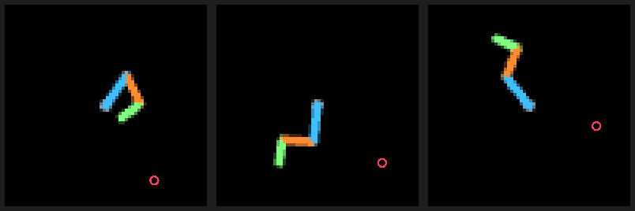
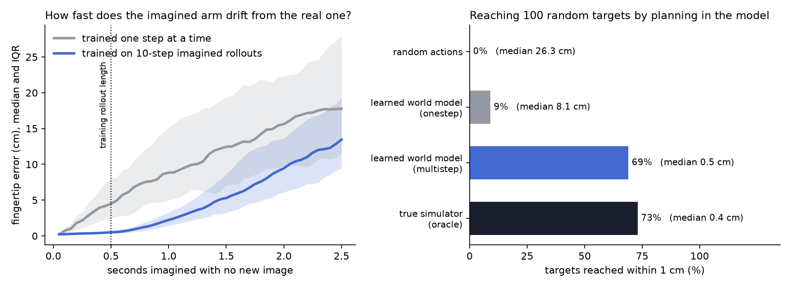
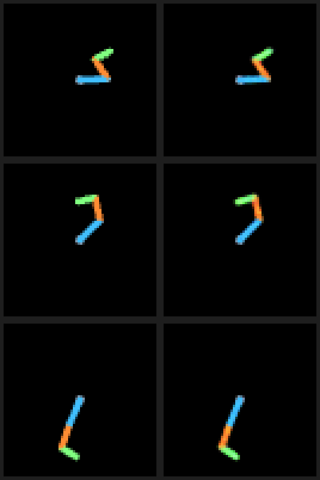

# robot-world-model

A robot arm controlled by planning inside a neural network's imagination. The network learned how the arm moves from camera images alone, and a sampling-based MPC (MPPI) uses it in place of a physics simulator.



Three reaches in the real MuJoCo simulator. The controller never calls the simulator to plan and never sees joint angles: it gets the camera image, imagines 512 possible futures in the learned model, and picks the best.

Planning in the learned model reaches **69 of 100** random targets to within 1 cm. The same planner given the true simulator and the true state reaches 73.

## Results



**Closed loop: reaching 100 random targets** (3-link arm, 32 cm reach, 4 seconds per target, success = fingertip within 1 cm averaged over the final 0.25 s):

| Planner's model | Targets reached | Median final distance | Time per plan |
|---|---|---|---|
| Random actions | 0% | 26.3 cm | |
| Learned world model, trained one step at a time | 9% | 8.1 cm | 5.2 ms |
| **Learned world model, trained on 10-step imagined rollouts** | **69%** | **0.5 cm** | **5.3 ms** |
| True simulator with true state (upper bound) | 73% | 0.4 cm | 10.9 ms |

**Open loop: how far does the imagined arm drift?** The model sees one real observation, then predicts from actions alone. Median fingertip error:

| Imagined for | 0.05 s (1 step) | 0.25 s | 0.5 s | 1.0 s | 2.5 s |
|---|---|---|---|---|---|
| One-step training | 0.19 cm | 2.16 cm | 4.51 cm | 8.83 cm | 17.8 cm |
| 10-step rollout training | 0.23 cm | 0.34 cm | 0.50 cm | 2.23 cm | 13.5 cm |

What this shows:

- **The learned model is nearly as good as the simulator for control.** It solves 67 of the 73 targets the simulator-based planner solves, plus 2 that planner misses. The 25 targets neither reaches are the planner's limit, not the model's: a short-horizon sampler gets stuck when the direct path to a target runs into a joint limit.
- **One-step accuracy says almost nothing about usefulness.** The one-step-trained model is slightly *better* at predicting a single step (0.19 vs 0.23 cm) and nine times worse after half a second. As a planning model it reaches 9% of targets. The only difference is the training objective.
- **It is fast.** A full plan (512 rollouts of 12 steps, including encoding the image) takes 5.3 ms on a laptop GPU, about 190 Hz for a 20 Hz control loop, and half the time of rolling out MuJoCo itself on 8 threads.
- **The imagination has a horizon.** Predictions are tight out to the 0.5 s the model was trained to imagine, usable to about 1 s, and fall apart by 2.5 s:



Left: the real arm. Right: what the model imagines from the first frame and the action sequence, with no further images. It tracks closely at first, then blurs and dissolves. The planner only ever looks 0.6 s ahead and gets a fresh image every step, which is why control still works.

## How it works

- **The robot** (`env.py`): a 3-link planar arm in MuJoCo with velocity servos, viewed by a top-down 64x64 camera. The joints have inertia and lag (about half a second to reach commanded speed), so the next image depends on how fast the arm is already moving.
- **The data** (`collect.py`): 72,000 transitions of random exploration. No task, no reward.
- **The model** (`model.py`, 6.0M parameters):
  - *encoder*: two consecutive frames to 64 numbers (two frames so velocity is visible)
  - *dynamics*: (latent, action) to next latent. This small MLP is all the planner runs in its inner loop.
  - *decoder*: latent to image, to see what the model imagines
  - *readout*: latent to fingertip position, which the planner's cost uses
- **Training** (`train.py`): encode one real observation, roll the latent forward 10 steps with no further images, and require every imagined state to decode to the right picture and read out the right fingertip position. Errors that would compound during planning are penalized during training.
- **Planning** (`plan.py`): MPPI. Each control step samples 512 action sequences of 12 steps around the current plan, rolls them out in the model, weights them by how close the fingertip gets to the target, executes the first action and repeats. The learned model and the true simulator plug into the same planner through one function.

## Run it

```bash
pip install -r requirements.txt
python collect.py --episodes 1200 --out data/train.npz
python collect.py --episodes 150 --seed 1 --out data/test.npz
python train.py --unroll 10 --out ckpt/multistep.pt      # ~20 min on an M-series Mac
python train.py --unroll 1 --out ckpt/onestep.pt         # the ablation, ~6 min
python evaluate.py                                       # both tables, ~5 min
python viz.py
```

The trained model (`ckpt/multistep.pt`, 24 MB) is included, so `evaluate.py` works after the two `collect.py` commands.

## What was and was not shown

- **The fingertip readout was trained with ground-truth fingertip positions** from the simulator. At test time the controller uses only images, but this is supervised perception, not learned purely from pixels. Specifying the goal as an image would remove that.
- **Simulation only.** No real robot, no sensor noise, no camera calibration, no contact. The arm moves in free space.
- **A simple robot.** Three joints in a plane. This says nothing about whether the same recipe scales to a manipulator with contacts or a legged robot.
- **One training seed** per model and 100 evaluation targets. The gap between 69% and 73% is 4 targets and is within noise; the gap between 9% and 69% is not.
- **The one-step and multi-step models had the same number of gradient steps**, but each multi-step update sees 10 times as many frames, so the comparison is not equal in compute.
- **The planner settings were tuned using the true simulator** on a separate set of 30 targets, then applied unchanged to the learned model.
- The upper bound is not 100%. I left the targets unfiltered so the comparison stays fair to both models.

## Files

| File | What it does |
|---|---|
| `env.py` | The MuJoCo arm, camera and exploration policy |
| `collect.py` | Data collection |
| `model.py` | Encoder, latent dynamics, decoder, fingertip readout |
| `train.py` | Multi-step latent rollout training |
| `plan.py` | MPPI, with learned-model and true-simulator backends |
| `evaluate.py` | Open-loop drift and closed-loop reaching |
| `viz.py` | Figures and GIFs |

## Resume line

Trained a 6M-parameter latent world model of a MuJoCo robot arm from camera images and used it for sampling-based MPC (MPPI) at 5 ms per plan, reaching 69% of targets versus 73% for the same planner with the ground-truth simulator; multi-step rollout training raised success from 9% to 69%.

## References

- [Learning Latent Dynamics for Planning from Pixels](https://arxiv.org/abs/1811.04551) (PlaNet)
- [TD-MPC2](https://arxiv.org/abs/2310.16828)
- [Model Predictive Path Integral Control](https://ieeexplore.ieee.org/document/7487277) (MPPI)
- Companion project: [neural-pong](https://github.com/rkparikh77/neural-pong), the same idea on a game, playable in the browser
